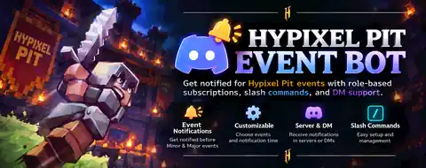

<div align="center">



<br>


# PitBell

**Discord reminders for selected Hypixel Pit events.**

Choose the events you care about and get mentioned before they start, either in a server channel or privately in DM.

</div>

---

## Getting started

Run:

```text
/pit help
```

PitBell supports two separate notification modes.

### Server notifications

A server manager runs:

```text
/pit setup
```

Optional arguments:

```text
/pit setup channel:#pit-events minutes:5
```

The setup panel is posted in the selected channel. Server settings require **Manage Server**.

### Personal DM notifications

Any user can run this from a server where PitBell is installed:

```text
/pit dm
```

PitBell will send that user a private setup panel in DM. Personal DM settings are separate from server settings.

You can also open a DM with PitBell directly and run:

```text
/pit setup
```

If PitBell cannot send you a DM, it returns a clear error telling you to check your Discord DM privacy settings.

## Features

- 🔔 Notifications for selected **Major** and **Minor** Pit events
- 🎛️ Native Discord multi-select menu
- ⚡ Quick buttons for **Minor**, **Major**, **All**, **Clear**, and **Pause / Resume**
- 💬 Server and personal DM notification modes
- ⏱️ Configurable reminders from 1 to 30 minutes before an event
- ⌛ Setup controls automatically expire while saved settings remain intact
- 🕒 Upcoming-event command with Discord timestamps
- 📺 Streaming presence showing the current or next Pit event
- 💾 Persistent configuration in `data/state.json`
- ⚡ Direct event-schedule fetching with no HTML scraping
- 🛡️ No Message Content privileged intent required
- ❌ User-facing error messages with an Error ID for troubleshooting

The bot uses the same public event schedule consumed by [brookeafk.com](https://brookeafk.com/).

## Commands

| Command | Description |
| --- | --- |
| `/pit help` | Show server and DM setup instructions |
| `/pit setup [channel] [minutes]` | Create or refresh the current setup panel |
| `/pit dm [minutes]` | Create or refresh your personal DM setup |
| `/pit upcoming [count]` | Show upcoming Pit events |
| `/pit status` | Show the current setup status |
| `/pit minutes value:5` | Change reminder lead time |
| `/pit pause` | Pause notifications without deleting settings |
| `/pit resume` | Resume notifications |
| `/pit reset` | Delete the current setup |

In a server, `/pit setup`, `/pit minutes`, `/pit pause`, `/pit resume`, and `/pit reset` require **Manage Server**. `/pit help`, `/pit dm`, `/pit upcoming`, and `/pit status` can be used without changing server configuration.

## Setup panel

The panel uses Discord message components instead of reactions:

- **Event dropdown** — choose one or multiple events
- **Minor** — select all Minor events
- **Major** — select all Major events
- **All** — select every supported event
- **Clear** — remove all selections
- **Pause / Resume** — stop or resume reminders without losing settings

By default, the interactive controls expire after **15 minutes**. The original message is updated to an expired state and the components are removed, but the selected events, reminder time, pause state, and notification target remain saved.

Run `/pit setup` for a fresh server panel or `/pit dm` for a fresh personal DM panel.

## Supported events

<table>
<tr>
<td valign="top">

### Minor

| Emoji | Event |
| --- | --- |
| 🧮 | Quick Maths |
| 🐲 | Dragon Egg |
| 2️⃣ | 2x Rewards |
| 📦 | Care Package |
| 🪜 | KOTL |
| 👑 | KOTH |
| 💵 | Auction |
| 🍰 | Giant Cake |
| 🪙 | All bounty |

</td>
<td valign="top">

### Major

| Emoji | Event |
| --- | --- |
| 🏳️ | Squads |
| 🐻 | Beast |
| 🍕 | Pizza |
| 🥔 | Rage Pit |
| 🏯 | Spire |
| 💸 | Robbery |
| 🧱 | Blockhead |
| 🎟️ | Raffle |
| 🆚 | Team Deathmatch |

</td>
</tr>
</table>

## Installation

### Requirements

- Node.js 20 or newer
- A Discord application with a bot user

```bash
git clone https://github.com/Riyoway/pit-event-bot.git
cd pit-event-bot
npm install
```

Create `.env` from the example:

```powershell
Copy-Item .env.example .env
```

Configure it:

```env
DISCORD_TOKEN=your_bot_token
DISCORD_CLIENT_ID=your_application_id
STREAM_URL=https://www.twitch.tv/hypixel
PANEL_TIMEOUT_MINUTES=15
```

> [!IMPORTANT]
> Never commit `.env` or your bot token.

## Discord application setup

Use **Guild Install** with these scopes:

- `bot`
- `applications.commands`

Recommended bot permissions:

- View Channels
- Send Messages
- Embed Links
- Read Message History

No privileged gateway intents are required.

The `/pit` command is registered globally with both **Guild** and **Bot DM** command contexts.

## Running

```bash
npm start
```

Syntax check:

```bash
npm run check
```

## Errors

Commands and component actions acknowledge Discord interactions before doing slower work, which avoids interaction timeouts during API or message operations.

When an operation fails, PitBell returns a user-facing message such as:

```text
❌ I could not send you a DM. Please enable DMs for this server and try /pit dm again.

Error ID: PIT-XXXXXX-XXX
```

The same Error ID is written to the bot console with the full error for debugging.

## Event data source

The bot fetches:

```text
https://raw.githubusercontent.com/BrookeAFK/brookeafk-api/main/events.js
```

Entries contain an event name, timestamp, and Major/Minor type. If a refresh fails, the last successfully fetched schedule is kept in memory.

## Runtime data

Configuration and duplicate-notification state are stored locally in:

```text
data/state.json
```

The file is ignored by Git and created automatically at runtime.

## License

MIT
